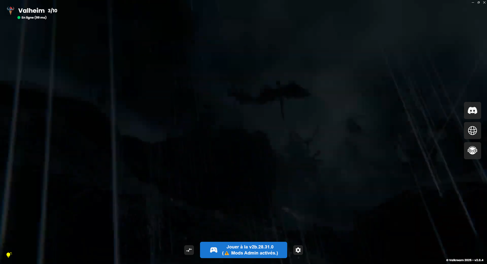

# Valkream-Launcher

Launcher et système de mise à jour pour le serveur Valheim Valkream.


## License

This project is under the **MIT Non-Commercial License (MIT-NC)**.

[](#license)

## Table des matières

- [Présentation](#présentation)
- [Fonctionnalités](#fonctionnalités)
- [Structure du projet](#structure-du-projet)
- [Installation (Développement)](#installation-développement)
- [Utilisation (Développement)](#utilisation-développement)
- [Test (Production)](#test-production)
- [Déploiement (Production)](#déploiement-production)
- [Auteurs](#auteurs)

---

## Présentation

Ce projet comprend :

- Un launcher Electron pour Valheim et 7days moddé
- Un serveur backend pour servir les fichiers pendant le développement

---

## Fonctionnalités

### Frontend (Electron Launcher)

- 🚀 **Téléchargement & mise à jour** du jeu (via HTTPS sécurisé)
- 🆚 **Vérification de la version** locale et en ligne du jeu/modpack
- 🧩 **Installation/Désinstallation** du jeu, des mods et du modpack via Thunderstore
- 🎉 **Gestion des événements spéciaux** (affichage dynamique dans l’interface)
- 🖥️ **Affichage des infos serveur** (joueurs, statut, ping, etc.)
- 🛡️ **Vérification d’intégrité** des plugins et configs (hash)
- 🎮 **Détection & gestion de l’installation Steam**
- 💬 **Notifications modernes** (snackbar, popup)
- 🖱️ **Interface multi-plateforme** (Windows, Linux, Mac)
- 🛑 **Mode maintenance** (affichage automatique si serveur en maintenance)
- 🌐 **Liens directs réseaux sociaux** (Discord, site web, top serveurs)
- 🔄 **Mise à jour automatique** du launcher via electron-updater
- 🎮 **Ouverture de steam** quand le jeu est lancé

> **⚠️ Attention** : A l'heure actuel l'installation cross-platforme ne fonctionne pas (seul windows fonctionne)

### Images

<br>
   
---

## Structure du projet

- `frontend/` : Le launcher Electron (interface utilisateur)
- `backend/` : Serveur Node.js pour servir les fichiers en dev

---

> **⚠️ Attention** : Certains fichiers et dossier sont masqués sous vscode. (ex: les dossiers `/node_modules`). Ces fichiers sont masqués via le fichier `.vscode/settings.json`

## Installation (Développement)

### Install Nodejs and npm Windows

```bash
winget install Schniz.fnm
fnm install 26
Set-ExecutionPolicy -ExecutionPolicy RemoteSigned -Scope CurrentUser
if (!(Test-Path $PROFILE)) { New-Item -Type File -Path $PROFILE -Force }; Add-Content $PROFILE 'fnm env --use-on-cd | Out-String | Invoke-Expression'
fnm default 26
```

### Installation des dépendances

À la racine du projet :

```bash
npm install -g corepack
yarn set version stable
yarn install
yarn workspace Valkream-Launcher rebuild
```

---

## Utilisation (Développement)

```bash
yarn dev
```

### Fichiers Zip du jeu

> **⚠️ Attention** : N'oubliez pas d'ajouter les zips `BepInEx` et `Valheim` dans le dossier `/backend/public` et sur votre serveur. Les `.zip` doivent contenir directement les fichiers (pas un dossier parent). `ex: https://play.valkream.com/game/Valheim/latest/`. Le fichier zip BepInEx peut être par exemple `le fichier thunderstore BepInEx` modifié pour que les fichiers soit à la racine. Le fichier zip Valheim peut quand à lui être une `installation neuve zippée` (avec les fichiers a la racine) ou une archive téléchargés depuis `steam`.

## Test (Production)

1. Pusher les modifications sur la main github
2. Attendre la fin du workflow de build
3. activer l'option de test beta dans le launcher sur le pc de test (settings -> crtl + maj + click sur l'image -> dev -> beta)
   <br>
   
   <br>
   
4. puis télécharger l'installer depuis github
5. mettre a jour le launcher sur le PC de test (via l'installer)
6. Lancer le launcher
7. Vérifier que le launcher fonctionne
8. Désactiver l'option de test beta dans le launcher (settings -> crtl + maj + click sur l'image -> dev -> beta)
   <br>
   
   <br>
   
9. Lancer le launcher (pour verifier que le beta est désactivé et que le launcher se met à jour)
10. Installer la mise à jour sur le serveur si tout est ok (voire la procédure dans le dossier de doc)

---

## Déploiement (Production)

Pour un déploiment `simple` en production, il suffit de copier le dossier public du backend sur un serveur de fichiers statique et de configurer le launcher pour utiliser le bonne url.

---

## Auteurs

- Jean-Chante (Valkream Team)

---
